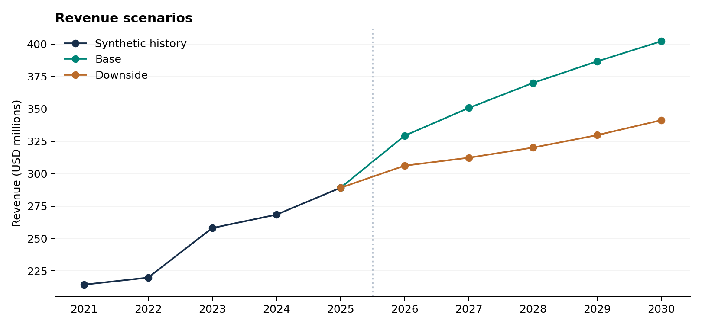

# Financial Modeling and Forecasting Portfolio

**Prepared for Yazhu Shen · Northstar Industrial Components · USD millions**

An applied work sample connecting operating data, revenue forecasting, linked financial statements and discounted cash-flow valuation. Northstar is fictional and all company data are simulated. This is a newly prepared skills demonstration, not a record of work for an employer or client.

## Start here

- [Read the portfolio report](report/Portfolio_Report.pdf)
- [Open the editable Excel model](model/Financial_Model.xlsx)
- [View the PowerPoint presentation](presentation/Portfolio_Presentation.pptx)
- [Preview the presentation as PDF](presentation/Portfolio_Presentation.pdf)
- [Read the native software instructions](docs/native_tools.md)
- [Review the independent checks](docs/independent_review.md)



## What the sample demonstrates

**Financial modeling.** A single Base/Downside selector drives one set of income statement, balance sheet, cash-flow and debt calculations. Cash and equity roll forward from business activity. The valuation uses unlevered cash flow and separates enterprise value from equity value.

**Statistical analysis.** A monthly driver regression is compared with a trend-and-seasonality model and a seasonal naive benchmark. A chronological 84-month training period is followed by a 12-month validation period. The source CSVs, coefficients, validation predictions and forecast metrics are included.

**Sensitivity analysis.** Operating assumptions affect the financial forecasts. A separate WACC/terminal-growth grid shows valuation sensitivity. The grid uses explicit formulas and reads the same active forecast as the main DCF.

**Communication.** The report explains the findings, assumptions and limitations. The editable slide deck presents the workflow and key numerical results.

## Execution status

| Component | Included | Status |
|---|---|---|
| Excel | Formula-based `.xlsx`, source data, assumptions, DCF, sensitivity | Calculated and checked; see model validation files |
| Python | Reproducible data and reference-analysis script | Executed; results included |
| Stata | Native `.do` script | Requires a local Stata run; no native run is claimed |
| EViews | Native `.prg` script | Requires a local EViews run; no native run is claimed |
| Power Query | M source query and input files | Requires loading and refreshing in Excel; not embedded in the workbook |
| Word and PowerPoint | Editable report and presentation | Exported and visually reviewed |

The same statistical specifications are provided in multiple tools. Cross-application numerical agreement should only be claimed after running the native scripts and comparing their outputs with the reference results.

## Reproduce the reference analysis

From the extracted project directory:

```bash
python -m pip install -r analysis/requirements.txt
python analysis/reproduce_analysis.py
```

The script regenerates the deterministic simulated data, regression coefficients, held-out predictions, annual forecasts, valuation results and analysis charts. It does not require a proprietary statistical application. Native-tool instructions are in `docs/native_tools.md`.

The Excel workbook contains populated data and formulas and can be reviewed without running Python. Editing the financial assumptions recalculates the forecast and valuation. Re-estimating the statistical models is a separate step; the statistical output tables are imported reference results, not live Excel regressions.

## A five-minute review

1. Open `model/Financial_Model.xlsx` and inspect the summary and valuation.
2. Switch `Assumptions!D4` from Base to Downside. Follow the effects on revenue, working capital, cash and equity value.
3. Change collection days and trace the effect through receivables and cash flow. Restore the input when finished.
4. Change WACC and compare the DCF with the sensitivity grid. Historical data should remain unchanged.
5. Open `analysis/forecast_validation.csv` and compare its predictions with the model-comparison chart and reported errors.

## Scope and interpretation

- Valuation date: 31 December 2025. Forecast years: 2026–2030. Monthly source period: January 2018–December 2025.
- The driver regression's holdout predictions use the **observed** validation-period industrial index. Its accuracy is conditional on that driver path and excludes macro-driver forecast error.
- Level forecasts use `exp(predicted log revenue)` without a smearing correction. They are monthly conditional median predictions, not unbiased conditional mean forecasts. Their annual sum is a planning projection, not a formally estimated annual conditional mean or median.
- HC1 standard errors address heteroskedasticity, not serial correlation. The regression describes association, not causation.
- The 2026 macro path is hypothetical. Growth after 2026 is an explicit scenario assumption, not a statistical forecast.
- The lowest-RMSE model is selected using one validation window. This is not an independent final test of the selection process. Rolling-origin validation and a further untouched test period would strengthen the analysis.
- Terminal value continues the final year's free cash flow at an assumed growth rate. A production valuation should separately examine steady-state margins, reinvestment and return on capital.
- Interest expense affects net income and cash. The unlevered DCF discounts pre-financing cash flow; interest-rate effects do not directly change FCFF at fixed operating assumptions and WACC.
- WACC, terminal growth and all financial drivers are illustrative assumptions. No market-calibrated investment recommendation is made.

## Package contents

| Folder | Purpose |
|---|---|
| `model/` | Editable workbook and its source builder |
| `data/` | Simulated monthly operating data, annual financials and future driver assumptions |
| `analysis/` | Reproducible Python reference, metrics, coefficients and forecast results |
| `scripts/` | Stata, EViews and Power Query source |
| `report/` | PDF and editable Word report |
| `presentation/` | Editable PowerPoint and its source builder |
| `visuals/` | Charts and selected workbook or slide previews |
| `docs/` | Native-tool instructions, independent checks and publication guide |

## Method references

- Damodaran, A. *An introduction to valuation*. NYU Stern. https://pages.stern.nyu.edu/~adamodar/New_Home_Page/background/valintro.htm
- Hyndman, R. J., & Athanasopoulos, G. *Forecasting: Principles and Practice* (3rd ed.), Chapter 5. https://otexts.com/fpp3/toolbox.html
- Native software documentation links are recorded in `docs/native_tools.md`.

## Sharing this portfolio

Upload the extracted directory to a GitHub repository, keeping `README.md` at the repository root, or place the PDF and workbook in a shared folder. Confirm that the link opens for a reviewer without access to your account. The application requests a portfolio URL; a local file path or ChatGPT download link should not be used as that public-facing URL.
